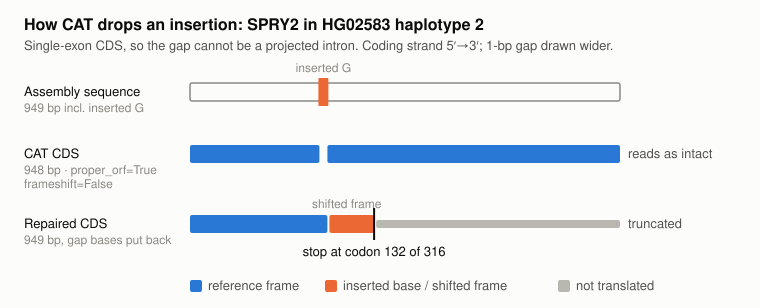
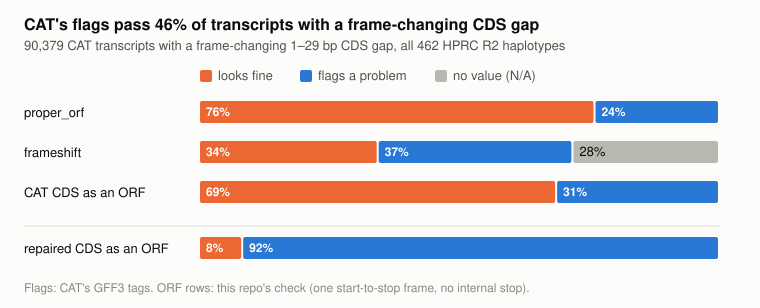
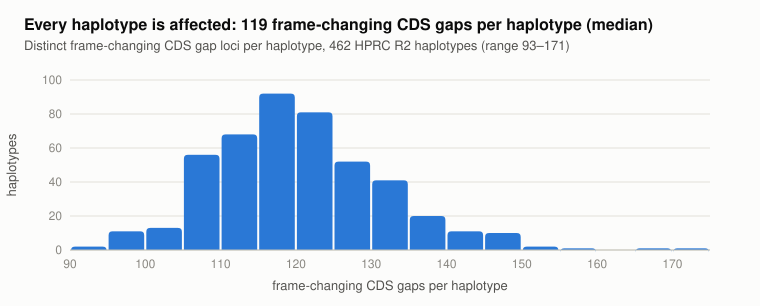
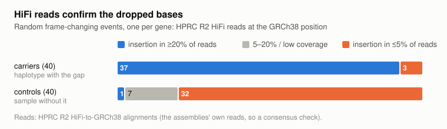
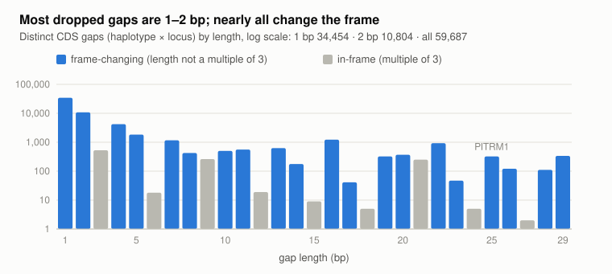

# hprc-fs-ins

**HPRC Release 2 CAT gene annotations leave frame-changing insertions out of
the CDS.** As a result, the annotated CDS looks intact when the assembly
actually carries a frameshift.

This repository shows the problem on public HPRC R2 data, and provides a
Python tool (`cat_gaps.py`) that finds the affected transcripts, puts the
missing bases back, and re-checks the ORF.

## The problem

When an assembly carries an insertion that shifts the frame, CAT keeps the
GRCh38 frame. It does this by splitting the CDS into two blocks around a
short (1–29 bp) gap that holds the inserted bases. The annotated CDS skips
those bases, so it stays in frame, often has exactly the reference length,
and usually keeps `proper_orf=True`.



CAT's own flags do not catch it. Of 90,379 affected CAT transcripts, 46%
pass both `proper_orf` and `frameshift`, and 69% read as intact ORFs until
the dropped bases are restored:



It is systematic. Every one of the 462 R2 haplotypes is affected, with
about 119 dropped frame-changing insertions each, across 1,795 genes:



The dropped bases are real assembly sequence. At random events, HiFi reads
carry the insertion in 37 of 40 carriers and in 1 of 40 controls:



**Consequence:** anyone who calls loss of function, pseudogenes or ORF
integrity from the CAT CDS, or trusts `proper_orf` / `frameshift`, will
undercount frameshift insertions. Frameshift deletions need no gap and are
mostly unaffected.

## Fix

```bash
uv sync
uv run cat_gaps.py download HG02583      # CAT GFF3 (both haplotypes) + Ensembl 114 GTF -> data/
uv run cat_gaps.py scan data/HG02583_hap2_hprc_r2_v1.0.1_cat_v1.3.gff3.gz \
    --fasta https://s3-us-west-2.amazonaws.com/human-pangenomics/working/HPRC/HG02583/assemblies/release2/HG02583_hap2_hprc_r2_v1.0.1.fa.gz \
    --gtf data/Homo_sapiens.GRCh38.114.gtf.gz --out hap2.tsv
grep -P '\tSPRY2\t' hap2.tsv
uv run cat_gaps.py hifi HG02583 chr13:80337414 --net 1    # 30 of 73 HiFi reads carry +1
```

For each CAT transcript, `scan` does three things:

1. **Find gaps.** It finds every gap under 30 bp between consecutive CDS
   blocks.
2. **Skip GRCh38 features.** It drops gaps that match a GRCh38 CDS "intron"
   of the same length at the same CDS offset. A few GRCh38 models contain
   such tiny introns: the programmed frameshifts in OAZ1/2/3 and PEG10, and
   1–2 bp gaps in SLC37A4, SHANK3 and ABO. CAT v1.3 projects GENCODE v48
   (Ensembl 114), and every source transcript ID matches.
3. **Restore and re-read.** It reads the gap bases from the assembly (a
   local path or an HTTPS URL), builds the repaired CDS, and reports whether
   the CAT CDS and the repaired CDS are intact ORFs. It also gives the
   approximate GRCh38 position of each gap, for read-level checks.

Use the repaired CDS, not the CAT CDS, before calling lesions.

## Worked example: SPRY2 in HG02583 haplotype 2

SPRY2 has a single-exon CDS (948 bp), so a gap inside it cannot be a
projected intron. CAT has three models of this locus on contig
`JBHIIV010000008.1` (minus strand):

| CAT transcript | source | mode | CDS blocks | CDS bp | `frameshift` | `proper_orf` |
| --- | --- | --- | --- | ---: | --- | --- |
| `HG02583_ha_T0328322` | SPRY2-201 `ENST00000377102.5` | transMap_pairwise | 69857282–69857938, 69857940–69858230 | 948 | **False** | **True** |
| `HG02583_ha_T0328323` | SPRY2-202 `ENST00000377104.4` | transMap | 69857282–69857938, 69857940–69858230 | 948 | True | **True** |
| `HG02583_ha_T0328324` | SPRY2-202 `ENST00000377104.4` | liftoff | 69857282–69858230 | 949 | **False** | **True** |

- **TransMap models:** both skip assembly base 69857939 (`G` on the coding
  strand). With that base restored, the CDS is 949 bp and stops at codon
  132 of 316.
- **Liftoff model:** it includes the base, yet is tagged `proper_orf=True`
  although 949 is not a multiple of 3.
- **Haplotype 1:** a single 948-bp CDS block with no gap.
- **HiFi reads:** the insertion is in 30 of 73 reads, as expected for a
  heterozygous insertion. It occurs in no other haplotype.

## Genome-wide results (all 462 R2 haplotypes)

Files in `results/`:
- `summary.md`: summary tables.
- `r2_cat_cds_gaps.tsv.gz`: one row per CAT transcript with a short CDS gap.
- `hifi_spotcheck.tsv`: the HiFi spot-check.

| | count |
| --- | ---: |
| CAT transcripts with a 1–29 bp CDS gap not explained by GRCh38 | 94,123 |
| — net frame-changing | 90,379 |
| distinct frame-changing gap events (haplotype × locus) | 55,401 |
| genes | 1,795 |
| CAT transcripts with a gap matching a GRCh38 CDS intron (left alone) | 18,491 |



The same mechanism shows up in two less common forms. `scan` handles both,
because it simply restores the bases and re-reads the ORF:
- **Next to a deletion.** CAT drops 1–4 bases beside a frameshift deletion,
  so the net change is a multiple of 3.
- **Restoring the frame.** Where the GRCh38 model is frame-disrupted relative
  to most haplotypes, the dropped insertion restores the frame. In GPATCH4
  (`ENST00000368232`), 458 of 462 haplotypes have a premature stop in the
  CAT CDS but an intact ORF once `GT` is restored. Overall, 8% of affected
  transcripts fall in this group.

**HiFi spot-check method** (`uv run report.py out --hifi 40`). It picks
random frame-changing events, one per gene, where the CAT CDS has the
reference length and reads as intact. It queries the carrier's HPRC R2
HiFi-to-GRCh38 alignment, and one sample with no gap in that transcript.
"Supported" means at least 20% of spanning reads carry an indel of the same
net length within ±10 bp; "absent" means at most 5%.

- **Unsupported carriers (3):** PITRM1 (see Limits), a 1-bp gap
  (ITGB1BP1), and a 10-bp repeat (SLC12A5).
- **Non-absent controls (8):** all are 1–2 bp A/T homopolymer insertions,
  mostly common ones. This fits HiFi homopolymer noise or an unflagged
  carrier.

## Limits

- **Gaps of 30 bp or more** are not restored, because by length alone they
  look like introns.
- **Not every short gap is a coding insertion.** The 25-bp PITRM1 gap,
  present in about two-thirds of haplotypes, ends in an acceptor-like
  `...TTCCCTAG` and lacks HiFi indel support. It is likely a shifted splice
  site. The repaired CDS is the assembly sequence; it is not a splicing
  prediction.
- **Common events** (present in most haplotypes) usually mean the GRCh38
  model carries the minor allele or is an unusual isoform. In that case a
  broken repaired ORF says more about the reference model than about loss
  of function.
- **GRCh38 positions** are approximate when the copy has other indels
  upstream of the gap.
- **The HiFi check** compares net indel length, not sequence. It uses the
  assemblies' own reads, so it is a consensus check, not an independent
  technology.
- **Counts are per CAT transcript.** CAT often has several models per locus
  (transMap, liftoff, alternative sources); event counts deduplicate loci.

## Files and reproduction

| file | |
| --- | --- |
| `cat_gaps.py` | `download` (CAT GFF3, optional assembly FASTA, GRCh38 GTF), `scan`, `hifi` |
| `report.py` | aggregate per-haplotype scans into `results/`; `--hifi N` spot-check |
| `figures.py` | redraw `figures/*.svg` from `results/` (`uv run figures.py`) |
| `test_cat_gaps.py` | synthetic checks (`uv run python test_cat_gaps.py`) |

Full run (about 51 GB of GFF3; each scan reads its assembly over HTTPS):

```bash
uv run cat_gaps.py download --all --out data
# for each haplotype in data/assemblies_release2_v1.0.index.csv:
uv run cat_gaps.py scan data/{assembly}_cat_v1.3.gff3.gz --fasta {assembly URL} \
    --gtf data/Homo_sapiens.GRCh38.114.gtf.gz --out out/{assembly}.tsv
uv run report.py out --hifi 40
uv run figures.py
```
